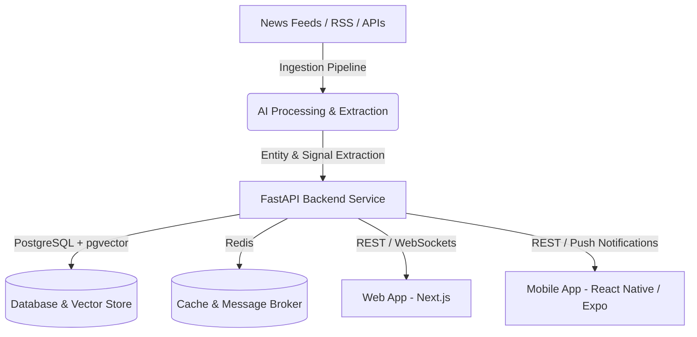

# CareerSignal System Architecture

## 1. High-Level Overview

CareerSignal is an AI-powered national and international job-news intelligence platform. It tracks real-time corporate employment signals (hiring sprees, mass layoffs, expansions, workforce restructurings, return-to-office policies) and provides geospatial analysis through an interactive hiring map.

---

## 2. Component Stack

| Layer | Technology | Key Responsibilities |
|---|---|---|
| **Backend API** | FastAPI (Python 3.11+) | REST endpoints, data validation, pipeline triggering, authentication |
| **Data Processing & AI** | Google Gemini API / LLMs | Natural language extraction of headcount changes, locations, and signal categories |
| **Database** | PostgreSQL 16 + pgvector | Relational entities, geospatial coordinates, embeddings for semantic news search |
| **Cache & Tasks** | Redis | Rate limiting, async task queuing, response caching |
| **Web Frontend** | Next.js (App Router, TS) | Responsive web dashboard, interactive global hiring map, intelligence feed |
| **Mobile App** | React Native + Expo (TS) | Cross-platform (iOS/Android) mobile alerts, quick digests, bookmarking |

---

## 3. Data Ingestion & Signal Extraction Pipeline

1. **Ingestion**: Automated workers pull global business news, regulatory layoff filings (e.g. WARN notices), and hiring announcements.
2. **AI Enrichment**: LLMs parse unstructured articles into structured signal records:
   - Event classification (`hiring_surge`, `layoff`, `expansion`, `restructuring`)
   - Company entity resolution
   - Geographic coordinates (latitude/longitude, city, country)
   - Estimated headcount impact and confidence level
3. **Distribution**: Real-time websocket pushes to web clients and push notifications to registered mobile devices.
